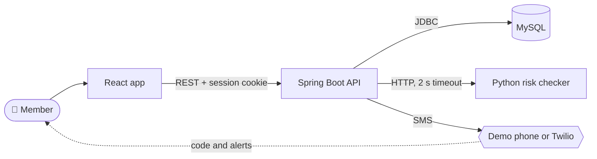
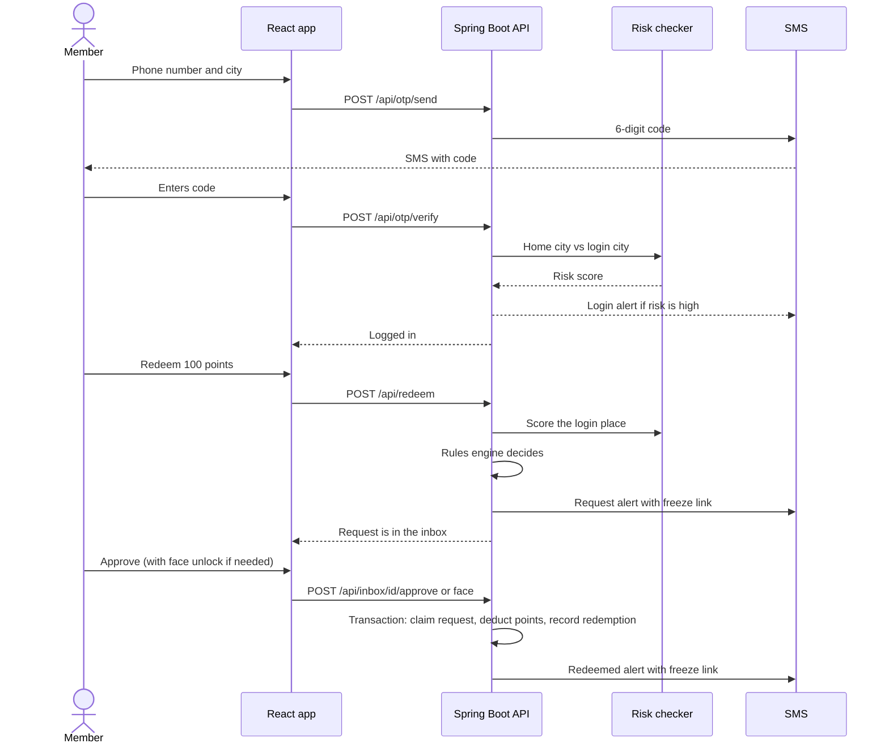
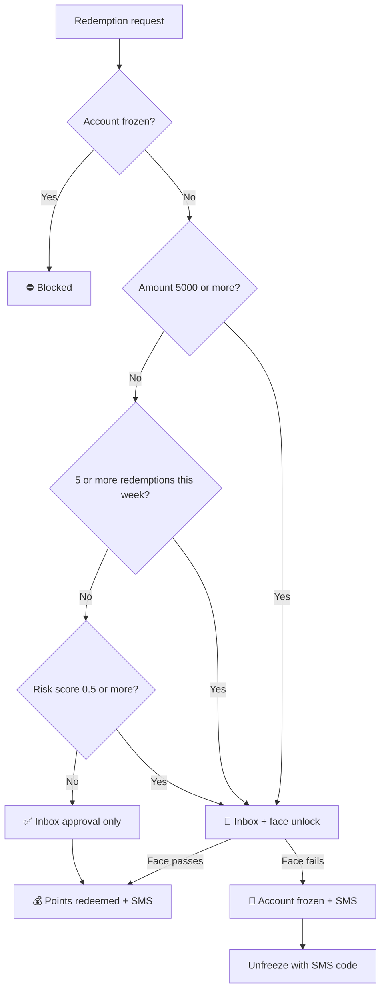
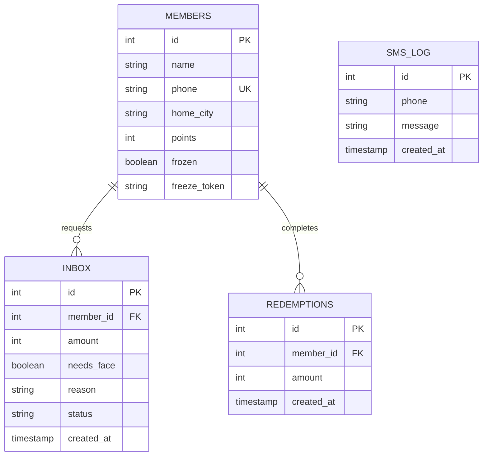

<div align="center">

# ✈️ SkyGuard Loyalty

### Airline loyalty points with built-in fraud protection

SMS OTP login · location risk scoring · step-up verification · one-tap account freeze


[Overview](#-overview) · [Screenshots](#-screenshots) · [Features](#-features) · [How it works](#-how-it-works) · [Run it](#-getting-started) · [Status](#-project-status) · [Limitations](#-limitations) · [Roadmap](#-roadmap)

</div>

---

## 📖 Overview

Loyalty points are real money. They buy flights, upgrades and gift cards, so they are a favourite target for account-takeover fraud. An attacker who gets into an account can drain the balance in minutes, and the owner often finds out too late.

**SkyGuard** is a full-stack prototype that shows how an airline loyalty programme can defend against this with several layers working together:

1. **Prove you own the phone.** Login needs a 6-digit SMS code.
2. **Check where the login is coming from.** A Python service scores the distance between the member's home city and the login city.
3. **Decide how much proof is needed.** A rules engine asks for an extra face-unlock step when the amount, the habit or the place looks unusual.
4. **Tell the owner immediately.** Every important event sends an SMS, and each SMS carries a link that freezes the account in one tap.
5. **Make recovery safe.** Freezing is instant, but unfreezing needs a fresh SMS code.

> ⚠️ **Prototype notice.** The face-unlock step is simulated (two buttons). Everything else in the flow is implemented. See [Project status](#-project-status) and [Limitations](#-limitations) for the full, honest picture.

---

## ✨ Features

| | Feature | Details |
|---|---|---|
| 📱 | **Phone check + OTP login** | Validates Indian mobile numbers, sends a 6-digit code, expires in 5 minutes, allows 3 tries, 30-second gap between resends |
| 🆕 | **Sign-up in the same flow** | A new number can register with a name and home city, and receives 20,000 welcome points |
| 🌍 | **Location risk checker** | Python service with 31 places (27 Indian cities plus Dubai, Singapore, London, New York). Scores distance from the home city and explains each score |
| 🧠 | **Rules engine** | Big amount, too many redemptions in a week, or a risky place leads to face unlock. A frozen account is blocked |
| 📥 | **Approval inbox** | Every redemption waits for the member to approve or decline it. Requests expire after 15 minutes |
| 💬 | **SMS alerts** | Login code, risky login, new redemption request, completed redemption, freeze and unfreeze |
| 🧊 | **Freeze from the SMS** | Each alert contains a link that freezes the account without logging in |
| 🔓 | **Unfreeze with a fresh OTP** | Freezing is easy, unfreezing is deliberate |
| 🔒 | **Safe redemptions** | One database transaction, with balance and frozen status checked again at approval, so points never go negative |
| 🖥️ | **React dashboard + demo phone** | A built-in phone panel shows every SMS, so the whole flow works without an SMS provider |
| 📡 | **Optional real SMS** | Switch to Twilio with three environment variables |
| 🧪 | **Automated tests** | 7 Python tests for the risk checker, 6 JUnit tests for the rules engine |

---

## ⚙️ How it works

### The big picture



### Login and redemption, step by step



### Decision flow



### Risk scoring

The risk checker compares the member's home city with the city they logged in from.

| Situation | Risk score | Face unlock? |
|---|---|---|
| Same area (50 km or less) | 0.10 | No |
| 51 to 600 km away, same country | 0.35 | No |
| 601 to 1500 km away, same country | 0.60 | **Yes** |
| More than 1500 km away, same country | 0.80 | **Yes** |
| Different country | 0.95 | **Yes** |
| City not in the list | 0.70 | **Yes** |
| Risk checker not reachable | 0.50 (fallback) | **Yes** |

The fallback is deliberate. If the checker is down, the system asks for **more** verification, not less.

Examples with a Mumbai home city: Pune (about 120 km) is normal. Delhi (about 1,150 km) needs face unlock. London needs face unlock.

---

## 🧱 Architecture

### Tech stack

| Layer | Technology | Why |
|---|---|---|
| Frontend | React 18 + Vite | Fast to build, one component file, no extra libraries |
| Backend | Java 17, Spring Boot 3.3 (Web, JDBC) | Clear layering, simple REST, transactions |
| Database | MySQL 8 | Relational data with foreign keys |
| Risk checker | Python 3, standard library only | Separate service, easy to swap for a real model later |
| SMS | Demo mode or Twilio REST API | Works offline for demos, real SMS when configured |
| Build and tests | Maven, JUnit 5, Python `unittest` | Standard tooling |

### Project structure

```
skyguard-loyalty/
├── frontend/                          React app
│   └── src/
│       ├── App.jsx                    Login, dashboard, inbox, demo phone
│       └── style.css
├── risk_advisor/
│   ├── app.py                         Risk checker service (port 5000)
│   └── test_risk.py                   Python tests
├── src/main/java/com/example/loyalty/
│   ├── LoyaltyController.java         All REST endpoints
│   ├── OtpService.java                Creates and checks SMS codes
│   ├── SmsService.java                Demo SMS or Twilio
│   ├── RulesService.java              Decision rules
│   ├── RiskClient.java                Calls the Python service
│   ├── LoyaltyRepository.java         Database queries and the redeem transaction
│   └── Member.java, InboxItem.java    Data records
├── src/main/resources/
│   ├── application.properties         Settings
│   ├── schema.sql                     Tables
│   └── data.sql                       Demo member
├── src/test/java/.../RulesServiceTest.java
```

<details>
<summary><b>🗄️ Database design</b></summary>



`sms_log` is only written in demo mode. It powers the demo phone panel. Request statuses are `PENDING`, `APPROVED`, `DECLINED` and `EXPIRED` (calculated when read).

</details>

---

## 🚀 Getting started

### Prerequisites

- JDK 17 or newer
- Maven 3.8 or newer (or IntelliJ)
- MySQL 8 running on port 3306
- Python 3
- Node.js 18 or newer

### 1. Clone and set the database password

```bash
git clone https://github.com/<your-username>/skyguard-loyalty.git
cd skyguard-loyalty
```

No password is stored in the repository. Set it as an environment variable in the terminal that runs the backend:

```bash
export DB_PASSWORD='your-mysql-password'          # macOS / Linux
$env:DB_PASSWORD = 'your-mysql-password'          # Windows PowerShell
```

The database `skyguard` is created automatically. The default user is `root`; change `spring.datasource.username` in `application.properties` if needed.

### 2. Start the three parts (three terminals)

```bash
# Terminal 1: risk checker
python3 risk_advisor/app.py

# Terminal 2: backend
mvn spring-boot:run

# Terminal 3: frontend
cd frontend
npm install
npm run dev
```

Open **http://localhost:5173** 🎉

> To serve everything from the backend on port 8080, run `npm run build` inside `frontend/` and open http://localhost:8080.

### 3. Try the demo

A demo member is created on first start: phone **`9999999999`**, home city **Mumbai**, **50,000** points. The demo phone panel shows every SMS, including the login code.

| Try this | What you should see |
|---|---|
| Log in from **Mumbai**, redeem 100 | Normal request: inbox approval only |
| Log in from **Pune**, redeem 100 | Still normal (about 120 km) |
| Log in from **Delhi**, redeem 100 | Risky place: face unlock needed, plus a login-alert SMS |
| Log in from **London** | Different country: very high risk |
| Redeem **5000 or more** | Large amount: face unlock needed |
| Press **Face fails** | Account is frozen and an SMS is sent |
| Click the **freeze link** in any SMS | Account freezes without logging in |
| Press **Send unfreeze code** on the frozen account | Fresh code arrives, enter it to unfreeze |
| Tick **I am new here** at login | Sign up with a new number and get 20,000 welcome points |

### Real SMS with Twilio (optional)

Demo mode is the default. To send real messages, set these variables before starting the backend:

```bash
export SMS_MODE=twilio
export TWILIO_SID=your_account_sid
export TWILIO_TOKEN=your_auth_token
export TWILIO_FROM=+1xxxxxxxxxx
```

Numbers are sent as `+91` plus the 10 digits. Change `loyalty.sms.country-code` for other countries, and set `loyalty.public-url` to your real address so freeze links work for recipients.

<details>
<summary><b>🎛️ All settings</b></summary>

| Setting | Default | Meaning |
|---|---|---|
| `DB_PASSWORD` (env) | empty | MySQL password |
| `loyalty.threshold` | `5000` | Amount that needs face unlock |
| `loyalty.weekly-limit` | `5` | Completed redemptions per 7 days before face unlock is forced |
| `loyalty.risk-url` | `http://localhost:5000` | Risk checker address |
| `loyalty.public-url` | `http://localhost:8080` | Address used inside freeze links |
| `SMS_MODE` (env) | `demo` | `demo` or `twilio` |
| `loyalty.sms.country-code` | `+91` | Prefix added for Twilio |
| `RISK_PORT` (env) | `5000` | Port of the risk checker |

</details>

### Run the tests

```bash
cd risk_advisor && python3 -m unittest -v     # 7 risk checker tests
mvn test                                      # 6 rules engine tests
```

<details>
<summary><b>🛠️ Troubleshooting</b></summary>

| Problem | Fix |
|---|---|
| Login page says the risk checker is not running | Start `python3 risk_advisor/app.py` and refresh |
| `Access denied for user 'root'` | `DB_PASSWORD` is wrong or not set in the same terminal or IntelliJ run configuration |
| `Communications link failure` | MySQL is not running on port 3306 |
| `Port 8080 already in use` | Close the other program using port 8080 |
| Buttons show errors but the page loads | The backend is not running yet |
| `mvn` is not recognized | Run `LoyaltyApplication` from IntelliJ and add `DB_PASSWORD` in the run configuration |

</details>

---

## 🔌 API reference

<details>
<summary><b>Show all endpoints</b></summary>

| Method | Path | What it does |
|---|---|---|
| GET | `/api/config` | Demo-mode flag and city list |
| POST | `/api/otp/send` | Validate the phone and send a code |
| POST | `/api/otp/verify` | Check the code and start a session |
| GET | `/api/me` | Current member |
| POST | `/api/logout` | End the session |
| POST | `/api/redeem` | Create a redemption request |
| GET | `/api/inbox` | List the member's requests |
| POST | `/api/inbox/{id}/approve` | Approve a normal request |
| POST | `/api/inbox/{id}/face` | Pass or fail the face-unlock step |
| POST | `/api/inbox/{id}/decline` | Decline a request |
| POST | `/api/freeze` | Freeze the account |
| GET | `/api/freeze/{token}` | Freeze link sent by SMS |
| POST | `/api/unfreeze/send` | Send an unfreeze code |
| POST | `/api/unfreeze` | Unfreeze with the code |
| GET | `/api/demo/sms?phone=` | Demo phone messages (demo mode only) |

Risk checker (port 5000): `GET /risk?home=Mumbai&login=Delhi` and `GET /cities`.

</details>

---

## 🛡️ Security decisions

What the project already does right:

- **OTP controls:** 6 digits from `SecureRandom`, 5-minute expiry, 3 tries, 30-second resend gap, and the code is deleted after use.
- **Session safety:** the session ID is changed on login, and the cookie is `HttpOnly` with `SameSite=Lax`.
- **CSRF resistance:** every state-changing request is a JSON `POST`, and no cross-origin access is enabled.
- **No SQL injection:** every query is parameterised.
- **Ownership checks:** an inbox item is always looked up by both its id and the logged-in member.
- **No double spending:** the redemption claims the request, deducts points only if the balance is enough and the account is not frozen, and records the redemption, all in one transaction.
- **Fail-safe defaults:** if the risk checker is down, the system asks for more verification. If SMS sending fails, the app keeps running.
- **No secrets in the repo:** the database password and Twilio keys come from environment variables.
- **Safe freeze design:** the freeze link can only freeze. It cannot spend or unfreeze.
- **Hidden internals:** the freeze token is never sent to the browser in API responses.

---

## ✅ Project status

| Area | Status | Notes |
|---|---|---|
| Phone validation + OTP login | ✅ Done | Expiry, tries, resend gap |
| New member sign-up | ✅ Done | Created only after the code is verified |
| Risk checker with 31 places | ✅ Done | Distance-based, with reasons |
| Rules engine | ✅ Done | Configurable thresholds |
| Approval inbox with decline and expiry | ✅ Done | 15-minute expiry |
| Transactional redemption | ✅ Done | No negative balances |
| SMS alerts + freeze links | ✅ Done | Demo mode tested in the UI |
| Unfreeze with OTP | ✅ Done | |
| React dashboard + demo phone | ✅ Done | |
| Unit tests | ✅ Done | Risk checker and rules engine |
| Twilio SMS delivery | 🟡 Implemented, not tested live | Needs a Twilio account to verify |
| Face unlock | 🟠 Simulated | Placeholder buttons |
| Java API integration tests | ❌ Not built | |
| Device and IP risk signals | ❌ Not built | |
| Admin dashboard | ❌ Not built | |
| Deployment and CI | ❌ Not built | |

---

## ⚠️ Limitations

This section is deliberately thorough. Knowing what a system does **not** do is part of building it properly.

### 🔴 Security

| # | Limitation | Why it matters | Planned fix |
|---|---|---|---|
| 1 | **Face unlock is simulated.** The buttons post `pass` or `fail`, so a client could post `pass` directly | The strongest step-up check can be bypassed | Real WebAuthn or passkey verification, checked on the server |
| 2 | **The login city is chosen by the user** | Anyone can pick the home city to look safe. This is the weakest part of the risk check | Detect location from the IP address and combine it with device signals |
| 3 | **Unfreeze relies on the phone alone** | A SIM-swap attacker who controls the number can unfreeze the account | Add a second factor or a waiting period before unfreezing |
| 4 | **Approval happens in the same session as the request** | An attacker already inside a session can approve their own request | Send approvals to a separate trusted device |
| 5 | **Freeze links never expire and never change** | Anyone who sees the link can freeze that account (a nuisance, not a theft) | Single-use or expiring links |
| 6 | **The freeze action uses a GET request** | Link previewers or scanners could freeze an account by accident | Show a confirmation page, then freeze on POST |
| 7 | **No HTTPS** | Traffic and cookies are readable on an open network | TLS in front of the app, `Secure` cookie flag |
| 8 | **No rate limiting by IP, no CAPTCHA** | Attackers can flood the OTP endpoint or guess codes across many numbers | Per-IP limits and bot protection |
| 9 | **The login screen reveals whether a number is registered** | Allows checking which numbers have accounts | Same response for known and unknown numbers |
| 10 | **Demo mode shows SMS messages, including codes, in the browser** | Fine for a demo, unsafe in real use | Run with `SMS_MODE=twilio` outside demos |
| 11 | **Demo member and its freeze token are in `data.sql`** | Known credentials in a public repo | Remove the seed data outside the demo |
| 12 | **Database runs as `root`** | Too many privileges | Dedicated database user with limited rights |

### 🟠 Risk engine

| # | Limitation | Planned fix |
|---|---|---|
| 13 | Only the login **place** is scored. Device, IP, time of day and past habits are ignored | Multi-signal score: IP geolocation, new-device detection, redemption velocity, usual redemption size |
| 14 | Only 31 cities are known. Other places get a flat score of 0.7 | Use a geocoding API or a larger place database |
| 15 | Scores come from fixed distance bands, not from data | Train a model on labelled or synthetic fraud data |
| 16 | The Python service is built on `http.server` with no authentication | Move to FastAPI, add an internal API key, containerise it |

### 🟡 Reliability and scale

| # | Limitation | Planned fix |
|---|---|---|
| 17 | OTP codes live in memory: lost on restart, and only one server instance works | Store codes in Redis with a time-to-live |
| 18 | Sessions are in memory, so the app cannot scale across servers | Spring Session with Redis |
| 19 | SMS is sent inside the request, so a slow provider slows the user | Send SMS from a background queue with retries |
| 20 | Twilio delivery has not been tested against a live account | Test with a real account and add delivery status handling |
| 21 | India requires registered SMS templates and sender IDs (TRAI DLT) for production messages | Register through a local provider before real use |
| 22 | Inbox shows only the latest 20 requests, with no pagination | Paging and filters |

### 🔵 Product

| # | Limitation |
|---|---|
| 23 | Points cannot be earned. There are no flights, bookings, tiers or expiry |
| 24 | Redeeming only reduces a balance. There is no reward catalogue |
| 25 | No transaction history page beyond the inbox |
| 26 | No admin or fraud-analyst view for blocked and flagged attempts |
| 27 | Signing up gives free welcome points (demo behaviour) |
| 28 | No email or push notifications as a backup for SMS |
| 29 | English only, and accessibility has not been audited |

### 🟣 Engineering

| # | Limitation | Planned fix |
|---|---|---|
| 30 | No Java integration tests for the redeem, approve and freeze flow | Spring Boot tests with Testcontainers (MySQL) |
| 31 | No frontend tests | Vitest and React Testing Library |
| 32 | No CI pipeline, Docker setup or deployment | GitHub Actions, Docker Compose, free-tier hosting |
| 33 | No database migrations. Tables are created from `schema.sql` | Flyway or Liquibase |
| 34 | No audit log of security events | Append-only event table |
| 35 | No structured logging or monitoring | Logging with request IDs and basic metrics |

---

## 🗺️ Roadmap

### Phase 1: Make the security real
- [ ] Real face unlock with WebAuthn passkeys
- [ ] Detect location from IP address instead of a dropdown
- [ ] Single-use, expiring freeze links with a confirmation page
- [ ] Rate limiting and CAPTCHA on OTP requests
- [ ] HTTPS and secure cookies

### Phase 2: Make the risk engine smart
- [ ] Device fingerprint and new-device detection
- [ ] Velocity and amount-pattern signals
- [ ] A trained model (logistic regression or gradient boosting) behind a FastAPI service
- [ ] Reason codes for every decision, kept for review
- [ ] Larger place database via a geocoding service

### Phase 3: Make it production-ready
- [ ] OTP and sessions in Redis
- [ ] Queue-based SMS with retries and delivery status
- [ ] Flyway migrations
- [ ] Java integration tests with Testcontainers, frontend tests with Vitest
- [ ] Docker Compose for MySQL, backend, risk checker and frontend
- [ ] GitHub Actions pipeline and a hosted demo

### Phase 4: Make it a fuller product
- [ ] Earn points from flights, with tiers and expiry
- [ ] Reward catalogue and full points history
- [ ] Admin dashboard for flagged and blocked attempts
- [ ] Email and push notifications
- [ ] Mobile app (React Native) with native biometrics

### Phase 5: Stretch ideas
- [ ] Alerts through WhatsApp Business
- [ ] Trusted-contact approval for large redemptions
- [ ] Anomaly detection on redemption streams
- [ ] Multi-language support

---

## 🧑‍💻 Skills demonstrated

- Designing a layered **fraud-prevention flow** (authentication, risk scoring, step-up, alerting, recovery)
- **REST API design** with Spring Boot, JDBC, session handling and transactions
- **Service-to-service calls** with timeouts and safe fallbacks
- **Concurrency-safe data updates** using guarded SQL inside a transaction
- A **React** single-page app with a small, readable codebase
- **Polyglot architecture:** Java, Python and JavaScript working together
- Third-party **SMS integration** with a demo-mode fallback
- **Unit testing** in two languages
- Honest **documentation of trade-offs and limitations**

---

<div align="center">

If you found this project useful, consider giving it a ⭐

</div>
